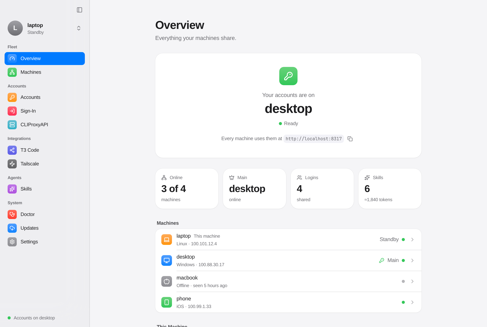

**spillup** is [spinup](https://github.com/darkyeg/spinup) with a dashboard: run `spinup ui` to manage your machines, the shared Claude/Codex accounts, the main machine, skills and checks from your browser.



### In v0.4.3

- **Phones look like iOS 26 again.** Large titles hand off to a centered title as you scroll, with a soft blurred edge behind it. Back and page actions float as glass buttons, and the glass tab bar's lens springs between tabs. The grouped lists use the iOS gray and black backgrounds.
- **Doctor → Preview support snapshot** produces a JSON download with diagnostic check IDs, recent HTTP outcomes, job states and machine health. You can inspect the complete export before saving it.
- **Remote → Stream quality** shows the active connection’s video bitrate, received and rendered FPS and dropped frames. WebRTC can also report peer round-trip time. Open network diagnostics in a separate tab while the stream keeps running.
- **Skills & MCP → Revision history** previews and restores locally recorded versions of shared `AGENTS.md` and authored `SKILL.md` files. The restored file syncs as a new edit. The CLI includes `spinup library history`, `diff` and `restore`.
- **Activity → Recent Actions** filters history by machine, component and outcome. Background jobs link back to their initiating request, including requests accepted before their job failed. A failed entry opens Doctor on the selected machine.

### Install

Windows (PowerShell):

```powershell
irm https://raw.githubusercontent.com/ig4e/spillup/master/scripts/install.ps1 | iex
```

Linux (Arch and others) and macOS:

```sh
curl -fsSL https://raw.githubusercontent.com/ig4e/spillup/master/scripts/install.sh | sh
```

Or download the binary for your system below (`spinup_windows_amd64.exe`, `spinup_linux_amd64`, …) and check it against `checksums.txt`.
