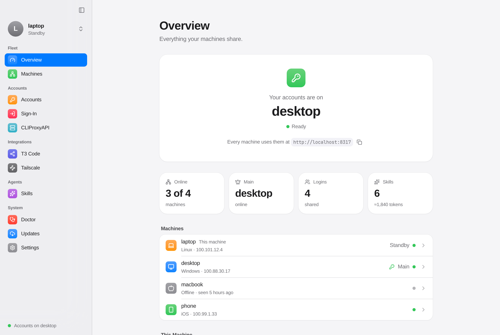
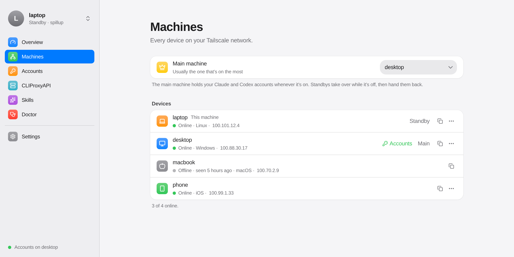
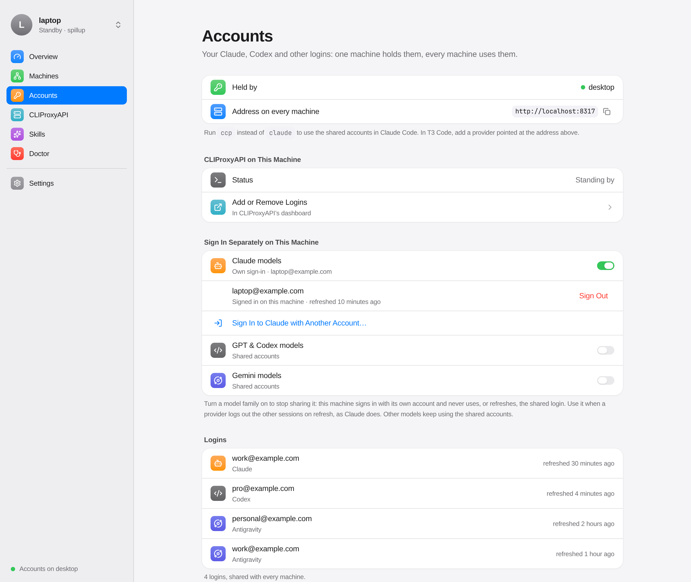
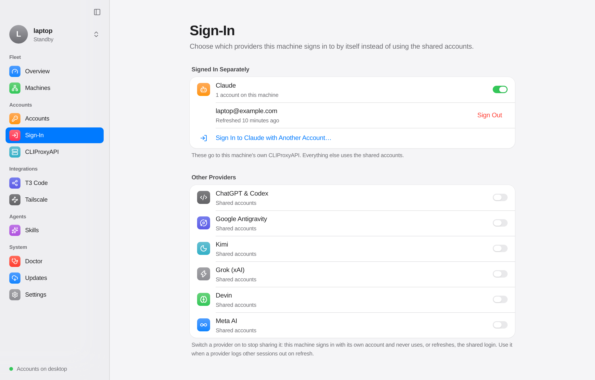
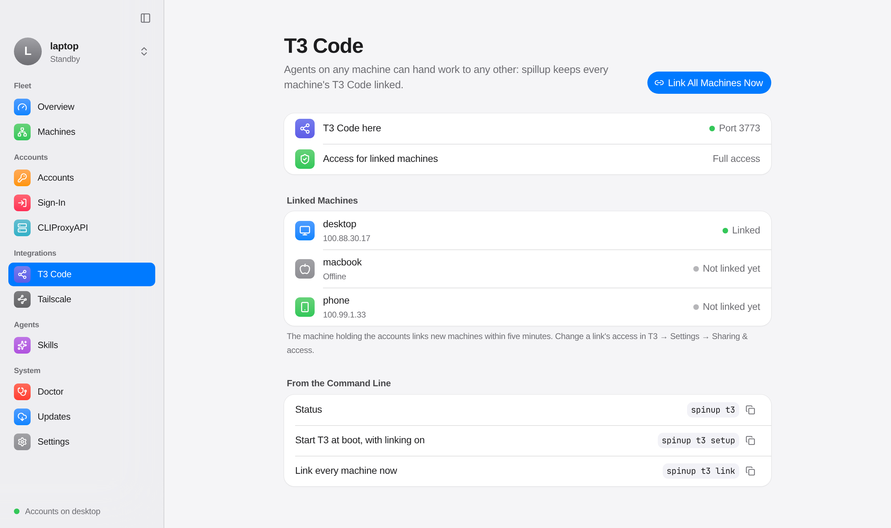
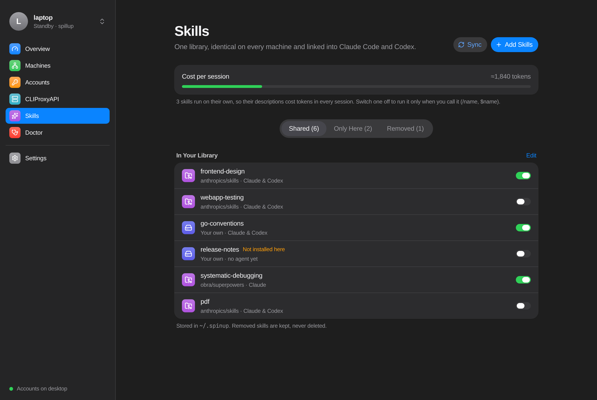
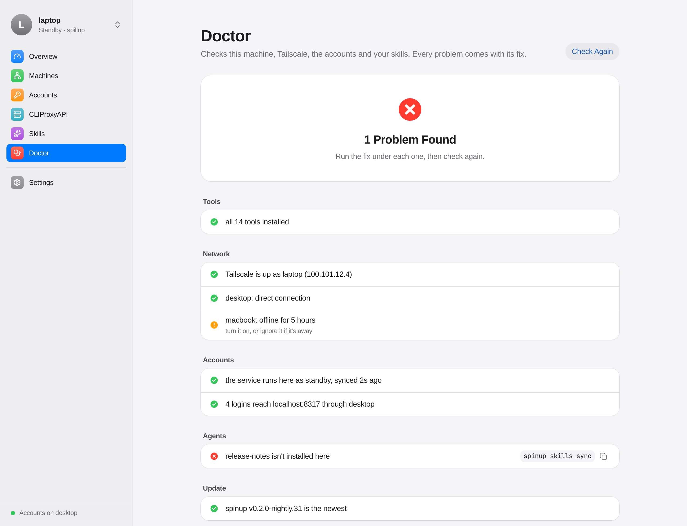
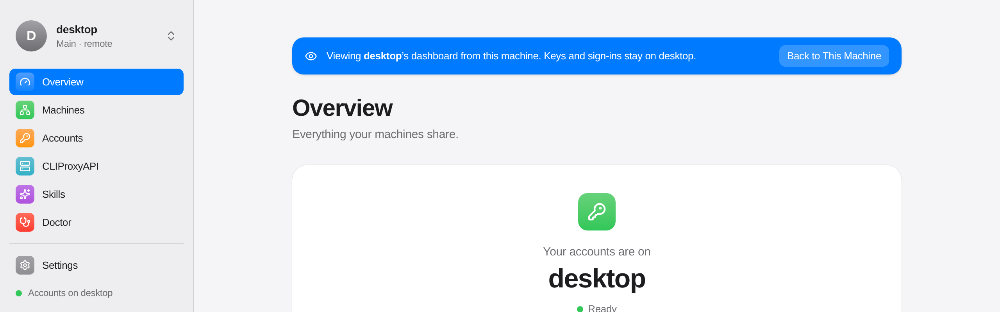

<div align="center">


# spillup

**Every computer you code with AI on, set up once, kept the same, and sharing your Claude and Codex accounts.**
**Managed from one dashboard, on Windows, macOS and Linux.**

[](https://github.com/ig4e/spillup/releases/latest)
[](https://github.com/ig4e/spillup/actions/workflows/ci.yml)
[](LICENSE)
[](#install)

<br>

<picture>
  <source media="(prefers-color-scheme: dark)" srcset="docs/screenshots/overview-dark.png">
  
</picture>

</div>

<br>

You have a desktop, a laptop, maybe a Mac. On each one you install the same tools, copy the same skills, and sign in to the same accounts — then watch them drift apart, and watch Claude log you out because two machines refreshed the same login.

spillup fixes that with one command per machine, then keeps everything in step by itself:

```sh
spinup setup my-desktop --hub
```

> spillup is [spinup](https://github.com/darkyeg/spinup) by [@darkyeg](https://github.com/darkyeg), plus an always-on dashboard, a main machine you can change, separate sign-in per machine, and CLIProxyAPI's own dashboard built in. The command is still `spinup`.

## What you get

| | |
|---|---|
| 🔑 **Your accounts, on every machine at once** | Every machine works with your subscriptions at the same time. One machine holds the logins and serves them all at `http://localhost:8317`. If it goes offline, a standby takes over and hands them back later — never two at once, so nobody gets logged out. |
| 👑 **A main machine you choose** | Make your desktop the main machine from the dashboard. Change it anytime; the accounts move between requests. |
| 🔐 **Every lab, and separate sign-in when you need it** | Claude, ChatGPT/Codex, Google Antigravity, Kimi, Grok, Devin, Meta AI — and any new kind of login spillup finds. Switch a provider to separate sign-in and that machine uses its own account, so no provider can revoke one machine's session when another refreshes. |
| 🏠 **Your choice of where logins live** | Copied to standbys so a standby takes over while the main machine is off, or **main machine only**, so no login file ever leaves it. Switch it on the Accounts page. |
| 🤝 **Joins by itself** | A new machine on your own Tailscale account gets its keys from the main machine automatically — no passwords to copy. Your existing CLIProxyAPI key keeps working, so your tools need no changes. |
| 🧩 **T3 Code, linked everywhere** | T3 Code starts at boot on every machine, and spillup links each one to all the others, so an agent anywhere can hand work to any machine. |
| ✨ **Per-item sharing** | Share skills, instructions, plugins and MCP definitions through the library. Each skill and MCP server can also have a private working copy. |
| 🖥️ **One dashboard for the fleet** | Always on at `http://localhost:8320`. From the main machine, open any other machine's dashboard too. |
| 🩺 **A straight answer when something breaks** | `spinup doctor` (or the Doctor page) checks everything and gives the fix for each problem. |
| 🖥️ **Remote desktop to every machine** | Sunshine on each machine, Moonlight as the app, and a browser client right in the dashboard: reach and control any machine from any other, paired over Tailscale with no PINs to type. |
| ⬆️ **Keeps itself current** | spillup updates itself (switch it off under Doctor & Updates), deferring unattended restarts of the sole account holder. |

Under the hood: [Tailscale](https://tailscale.com) connects your machines privately, [CLIProxyAPI](https://github.com/router-for-me/CLIProxyAPI) shares the accounts, and one Go binary with no dependencies runs it all, 24/7, from boot.

## Install

<table>
<tr><th>Windows (PowerShell)</th><th>macOS and Linux</th></tr>
<tr>
<td>

```powershell
irm https://raw.githubusercontent.com/ig4e/spillup/master/scripts/install.ps1 | iex
```

</td>
<td>

```sh
curl -fsSL https://raw.githubusercontent.com/ig4e/spillup/master/scripts/install.sh | sh
```

</td>
</tr>
</table>

Then open a new terminal and check it: `spinup --version`. Prefer a download? Every [release](https://github.com/ig4e/spillup/releases/latest) has binaries for each system and a `checksums.txt`.

## Set up your machines

**1. The main machine** — the one that's on the most, usually your desktop. The name you pick becomes its address on your network.

```sh
spinup setup my-desktop --hub
```

This installs and signs in to **Tailscale** (use the same account on every machine), installs **CLIProxyAPI**, starts the accounts service, the dashboard and **T3 Code** at boot, and installs your dev tools, skills and agent settings. If you already ran CLIProxyAPI, it keeps that API key and takes in its logins. It ends with a health check. Then sign in your accounts: `spinup ui` → **CLIProxyAPI** → **OAuth Login**.

**2. Your other machines** — signed in to the same Tailscale account, they join by themselves; anything else asks for a key that `spinup keys` prints on the main machine.

```sh
spinup setup my-laptop --standby   # Worker + Standby: works, and takes over while the main machine is off
spinup setup my-mac                # Worker: works with the accounts through the main machine
```

**3. Use it.** Run `ccp` instead of `claude` to use Claude Code with the shared accounts (plain `claude` keeps its own login), or point T3 Code's providers at `http://localhost:8317` — see [docs/T3-PROXY.md](docs/T3-PROXY.md).

Every command is safe to re-run; re-running is how you repair. Prefer your agent to do it? Tell it *"set up this machine with spinup"* and it follows [docs/SETUP.md](docs/SETUP.md).

## The dashboard

Always on at **`http://localhost:8320`**, hosted by the background service on every machine. Run `spinup ui` once to open it signed in, then bookmark it. It follows your system's light and dark mode.

<table>
<tr>
<td width="50%" valign="top">

**Machines** shows the verified Spillup computers on your tailnet and the current account holder. Choose a new main machine to move the accounts there and make the previous holder a standby.

</td>
<td width="50%"></td>
</tr>
<tr>
<td valign="top">

**Accounts** — who holds your subscriptions, each login's live status from CLIProxyAPI (active, cooling down, signed out), and how to use them in the apps this machine actually has.

</td>
<td></td>
</tr>
<tr>
<td valign="top">

**Sign-In** — every provider CLIProxyAPI can sign in to, plus any other kind of login it finds. Switch one on and this machine signs in with its own account; requests for that provider's models go to this machine's own CLIProxyAPI.

</td>
<td></td>
</tr>
<tr>
<td valign="top">

**T3 Code** shows automatic links for agent delegation. Under **Desktop connections**, open a machine in T3 and confirm the pairing. You can then select that machine in **Add Project**.

</td>
<td></td>
</tr>
<tr>
<td valign="top">

**Skills** manages private and shared skills: choose which run automatically and see their token cost. **MCP Servers** manages private and shared MCP definitions and approves them for individual agents.

</td>
<td></td>
</tr>
<tr>
<td valign="top">

**Doctor & Updates** puts checks and fixes in the **Checks** tab. Choose **Preview support snapshot** to inspect and download diagnostic codes and recent outcomes. The **Updates** tab shows installed versions and lets you preview a fleet rollout.

</td>
<td></td>
</tr>
<tr>
<td valign="top">

**Any machine, from the main one** — use the switcher at the top of the sidebar, *Open Dashboard* on a device, or `http://localhost:8320/?machine=<name>`.

</td>
<td></td>
</tr>
</table>

**Remote** opens a paired Sunshine desktop or app in Spillup’s browser player. Use the toolbar to paste text, copy the host clipboard, toggle sound, go full screen, or disconnect. Clipboard transfer is plain text, up to 64 KiB per action. Copy requires device access on the host and a signed-in desktop session. On browsers that restrict clipboard access, the player offers a text field.

**Machines** shows changes in Tailscale reachability, Spillup, account sync and T3 linking. **Activity → Recent Actions** keeps up to 100 dashboard actions and 50 jobs per machine. Filter by component or outcome, expand a failed job to see its initiating request, and open Doctor on that machine. **Accounts** shows provider health and observed usage windows on workers as well as holders. **Settings** previews local setup changes. **Doctor & Updates** runs machine checks, manages updates and previews the fleet rollout.

<details>
<summary><b>How the dashboard stays safe</b></summary>

- The local dashboard uses the session from `spinup ui`. With device access enabled, the Tailnet dashboard also admits devices on the same Tailscale account.
- Shared quota summaries contain provider health, usage percentages and observation times. The holder keeps the management credential and upstream responses on its own machine.
- Open **Stream quality** in the player toolbar to see video bitrate, received and rendered frame rates and dropped frames. WebRTC can also report round-trip time. On the WebSocket fallback, the panel counts frames the decoder skipped.
- Clipboard reads require an explicit copy action in the player, a paired Sunshine host with an active application, device access, and a same-owner peer with the fleet API key. Clipboard contents are excluded from history.
- Set `ui_port` to `0` to turn off the dashboard.

</details>

## How it works

```
 your programs ── localhost:8317 ──┐                        ┌── this machine's own CLIProxyAPI
                                   ├── spillup on each ─────┤     (only for families you sign in to separately)
 phone on Tailscale ── <hub>:8317 ─┘   machine              └── the holder's CLIProxyAPI, over Tailscale
                                         private Tailscale network
```

- **Names, not IPs.** Tailscale gives each machine a fixed private address and the name you chose. At home traffic goes straight over your router; away, over the internet.
- **No machine list to keep.** Tailscale is the list; spillup reads it.
- **One holder at a time.** A standby takes over only when Tailscale reports the holder offline for three minutes — never just because it can't be reached. That's what stops two machines refreshing the same login.
- **Always running.** The service starts at boot before anyone logs in (an S4U scheduled task on Windows, a lingering systemd user unit on Linux) and restarts if it stops.
- **Changes travel in seconds.** Your library reaches every online machine; offline ones catch up when they return.

Port `8317` is spillup's router, `8320` the dashboard; CLIProxyAPI uses `8327` (shared, on the holder) and `8328` (separate sign-in), on `127.0.0.1` only. In plain words: [docs/HOW-IT-WORKS.md](docs/HOW-IT-WORKS.md) · safety design: [docs/DESIGN.md](docs/DESIGN.md) · day to day: [docs/SERVICE.md](docs/SERVICE.md).

## Commands

| | |
|---|---|
| `spinup setup <name> [--hub\|--standby]` | Set up or repair the whole machine |
| `spinup ui` | Open the always-on dashboard, signed in |
| `spinup doctor` | Check everything; each problem comes with its fix |
| `spinup rollout` | Preview a staged release. Run `spinup rollout --apply` on the hub to update followers one at a time and verify each running service. |
| `spinup update` | Update spillup, CLIProxyAPI, skills and Tailscale |
| `spinup status` | Who holds the accounts, every login, every machine |
| `spinup handoff <machine>` | Move the accounts to another machine, safely |
| `spinup machines` | Every device on your network and its address |
| `spinup skills` | Your skills for Claude Code and Codex |
| `spinup mcp` | Local and shared MCP definitions, per-agent approvals and named secret transfers |
| `spinup library` | Preview or restore a shared instruction document from this machine’s history |
| `spinup packages` | Complete plugins, pinned revisions, native installation and rollback |
| `spinup agents` | Shared and personal instructions; keeps your model choices and settings |
| `spinup repo <path> [--apply]` | Get a project ready for agents: stack skills, AGENTS.md, git remote |
| `spinup tools` | Install the dev tools a machine lacks |
| `spinup keys` | The API key here; the dashboard password on a hub or standby |
| `spinup t3 [setup\|link]` | Start T3 Code at boot and link agents across machines |
| `spinup t3 connect <machine>` | Open a machine in T3 Desktop to work on its projects |
| `spinup remote [setup\|pair]` | Remote desktop: Sunshine, Moonlight and the browser client, paired between every machine |

`spinup <command> --help` explains each one.

<details>
<summary><b>Skills, plugins and your own instructions</b></summary>

Shared skills travel through your **library** (`~/.spinup`) and install into Claude Code and Codex. You can keep a skill private from the start, pause updates on this machine, or publish your local edits later. Manage sharing in **Skills** and **MCP Servers**.

| You have | Do |
|---|---|
| A private or shared MCP server | **MCP Servers** or `spinup mcp`. See [MCP servers and secret sharing](docs/MCP.md). |
| A skill only this machine has | Skills → **Only Here** → **Keep Everywhere** (or `spinup skills adopt`) |
| A folder or `.zip` someone sent you | `spinup skills import <path>` |
| A new idea | `spinup skills new <name>` |
| A skill on GitHub | Skills → **Add Skills** (or `spinup skills add <owner/repo> <skill>`) |

**Auto or manual?** An auto skill's description costs tokens in every session; a manual one costs nothing until you call it (`/name` in Claude Code, `$name` in Codex).

Complete plugins such as Superpowers: `spinup packages add obra/superpowers` — pinned, installed through each tool's own plugin manager, with `plan`, `update`, `rollback` and `remove` ([docs/PACKAGES.md](docs/PACKAGES.md)). Your own instructions: create `~/.spinup/AGENTS.md`, then `spinup agents` ([docs/AGENT-CONFIG.md](docs/AGENT-CONFIG.md)). More: [docs/LIBRARY.md](docs/LIBRARY.md).

</details>

<details>
<summary><b>Good to know</b></summary>

- **A Mac shouldn't be your main machine.** Its service runs only while you're logged in. Use an always-on Windows or Linux machine.
- **Agent settings are merged locally, not copied.** Credentials and machine-specific paths stay on each machine.
- **A phone** without spillup points at an online hub or standby by name (`http://my-desktop:8317`) with the API key.
- **Releases** publish automatically from every push to `master`, for Windows, Linux and macOS. `spinup update` installs them.
- **Before trusting a new build** across machines, follow the [validation guide](docs/VALIDATION.md).

</details>

## Security

- **Nothing faces the internet.** Everything is reachable only on your tailnet, and Tailscale traffic is end-to-end encrypted. On Windows a firewall rule limits the port to Tailscale addresses.
- **Keys stay on your machines** (`secrets.json`, never committed). Machines prove they know the key before any login is sent to them.
- **Downloads are checksum-verified**, both spillup's updates and CLIProxyAPI's.
- Turn on 2FA for **GitHub** and **Tailscale**, and disable Tailscale key expiry for your machines — the doctor warns you.
- Found a problem? [SECURITY.md](SECURITY.md).

> [!IMPORTANT]
> Routing subscription accounts through a proxy may conflict with your provider's terms. Read them and decide for yourself; you are responsible for how you use your accounts. spillup's own rule: use Claude accounts only through Claude Code (`ccp`, or T3 Code's Claude provider), never from other apps. An abrupt failure right after a login refresh can still mean signing that account in again: [the service limits](docs/SERVICE.md).

## Development

```sh
cd web && npm ci && npm run dev:mock    # the dashboard with a pretend fleet, at localhost:5173
npm --prefix web run build              # build it into the binary (internal/webui/dist)
go vet ./... && go test ./...           # then: go build ./cmd/spinup
```

Ideas and fixes are welcome: [CONTRIBUTING.md](CONTRIBUTING.md) · terms used everywhere: [GLOSSARY.md](GLOSSARY.md) · code map: [AGENTS.md](AGENTS.md).

## Credits

Built on [spinup](https://github.com/darkyeg/spinup) by [@darkyeg](https://github.com/darkyeg). Uses [CLIProxyAPI](https://github.com/router-for-me/CLIProxyAPI) and its [Management Center](https://github.com/router-for-me/Cli-Proxy-API-Management-Center), [Tailscale](https://tailscale.com) and [HeroUI](https://heroui.com).

## License

[MIT](LICENSE)
